<p align="center">
  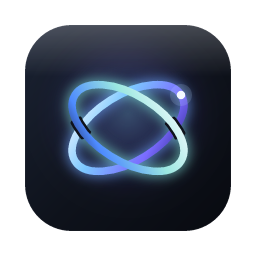
</p>

<h1 align="center">AetherLink</h1>

<p align="center">
  <a href="README.md">English</a> | <b>Italiano</b>
</p>

<p align="center">
  <b>Desktop remoto open source: ti colleghi direttamente e in sicurezza all'altro computer e ne usi
  schermo, file, porte e terminale come se fossero locali.</b>
</p>

<p align="center">
  <a href="https://github.com/giuseppegambino92/AetherLink/actions/workflows/windows-vfs.yml"></a>
  <a href="#licenza"></a>
</p>

AetherLink ti permette di vedere e controllare un altro computer in rete, come TeamViewer o AnyDesk, ma i
due dispositivi si collegano direttamente tra loro e tutto è cifrato end-to-end. Quando la connessione
diretta non è possibile, un relay che puoi ospitare tu stesso inoltra il traffico cifrato senza poterlo
leggere. È pensato per chi lavora su più macchine (gli sviluppatori in particolare): testo nitido, le
cartelle remote nel file manager, le porte remote su localhost, un terminale remoto a scomparsa.

<p align="center">
  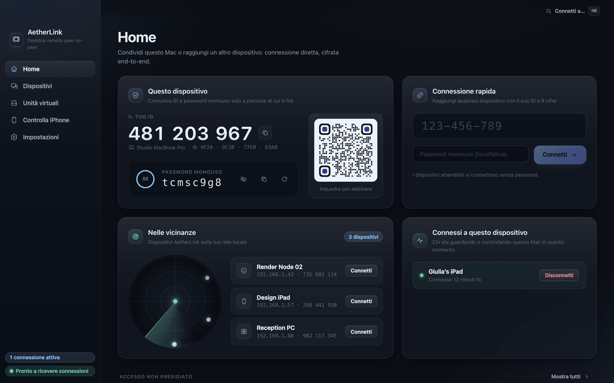
</p>

> **Stato: pre-alpha.** Ogni backend di piattaforma esiste nel codice e compila per il suo target; quanto di
> ciascuno sia stato davvero *eseguito* varia. La [matrice di stato](#matrice-di-stato) dice esattamente
> cosa è stato eseguito e dove.

## Provalo

Non ci sono ancora pacchetti già pronti da scaricare: AetherLink si compila dai sorgenti. Servono la
toolchain di Rust e Node.js. macOS è la piattaforma verificata da cima a fondo (vedi la
[matrice di stato](#matrice-di-stato)).

```sh
git clone https://github.com/giuseppegambino92/AetherLink.git
cd AetherLink/apps/desktop
npm install

# Per dare prima un'occhiata: l'interfaccia nel browser, con dati di esempio
npm run preview                       # http://localhost:5178/

# Compila l'app desktop
npx tauri build --bundles app
```

Tutti i comandi di compilazione, test e app mobili sono in [Compilazione e verifica](#compilazione-e-verifica).

## Cosa fa

### Un'immagine sempre nitida
- **Video ibrido.** HEVC 4:4:4 hardware (VideoToolbox, Media Foundation; OpenH264 come ripiego) per il
  movimento, più **riquadri di testo senza perdita** (rilevamento delle modifiche con xxh3, zstd, cache
  deterministica) che rifiniscono le zone ferme entro 80 ms: codice e caratteri piccoli si vedono
  esattamente come sullo schermo remoto.
- **Audio Opus** su datagrammi QUIC, con jitter buffer e scelta del dispositivo nella barra di sessione
  (ScreenCaptureKit, WASAPI loopback, PipeWire/Pulse).
- **Navigatore per schermi ultrawide:** una mappa picture-in-picture di tutti gli schermi remoti, con zoom
  e inseguimento del puntatore.

### Il computer remoto, come se fosse locale
- **Azioni semantiche con ⌘K.** Cerca per nome nell'albero dell'interfaccia remota (AXUIElement,
  UI Automation, AT-SPI), poi premi pulsanti, apri menu o scrivi nei campi senza doverli cercare sullo schermo.
- **Unità montate nel sistema.** Le cartelle remote compaiono nel Finder, in Esplora file o nel file manager
  (NFSv3 su macOS, WebDAV su Windows, FUSE su Linux), con cache a blocchi BLAKE3 e trasferimenti
  trascinando i file.
- **Appunti intelligenti.** Immagini e testo formattato vengono convertiti tra i formati delle piattaforme
  (TIFF/HEIC di macOS, DIBv5 e CF_HTML di Windows) passando per PNG/HTML.
- **Inoltro delle porte.** Elenca i servizi in ascolto sul computer remoto (SSH, Node, Postgres, Ollama…)
  e li porta su localhost con un interruttore.
- **Terminale a scomparsa.** Ctrl+` apre dall'alto una vera shell remota, già nella cartella che stai
  guardando.
- **DVR Time-Travel di 3 minuti.** Torna indietro negli ultimi tre minuti con gli eventi segnati sulla
  timeline e copia il testo da qualsiasi fotogramma passato con l'OCR sul dispositivo. Il buffer è cifrato
  con una chiave che non lascia mai la RAM.

### Privacy e computer senza monitor
- **Modalità Ghost.** Lo schermo remoto si oscura per chi gli sta davanti (una finestra-sipario al livello
  di schermatura e la retroilluminazione portata a zero, poi ripristinata esattamente) mentre tu continui a
  lavorarci. Ctrl+Opt+Cmd+Esc la disattiva in locale.
- **Schermi virtuali.** Aggiungi uno schermo 1080p, 1440p o 32:9 a un Mac senza monitor collegato.

### iPhone, iPad e telefoni
- **Controlla un iPhone o un iPad** trasformando questo computer, o un economico dongle ESP32-S3, in una
  tastiera e un trackpad Bluetooth. iOS non permette il controllo remoto via software: così lo si aggira.
- **App mobili** per Android (MediaProjection, AccessibilityService, Shizuku) e iOS (ReplayKit) per
  condividere o guardare un telefono.

### Sicurezza
- Identità del dispositivo Ed25519, ID a 9 cifre, password monouso a rotazione, **SPAKE2 legato a TLS 1.3**
  e dispositivi attendibili riconosciuti dalla chiave, con conferma facoltativa tramite Touch ID / Windows Hello.
- **Permessi per sessione:** la visione è sempre consentita; controllo, file, terminale, tunnel, USB e
  modalità Ghost sono interruttori separati (quelli più delicati partono spenti). Il relay, ospitabile in proprio, è
  **zero-knowledge**: inoltra pacchetti cifrati e non vede mai i contenuti.

## Screenshot

| | |
|---|---|
| 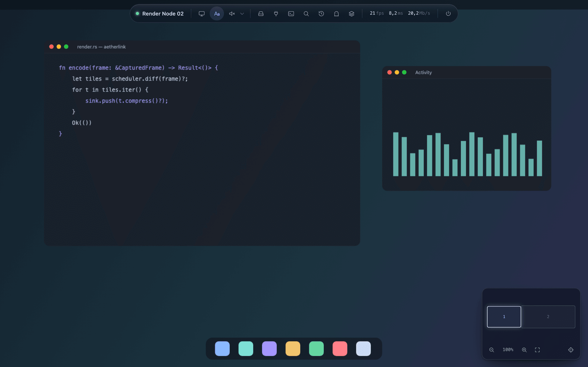 | 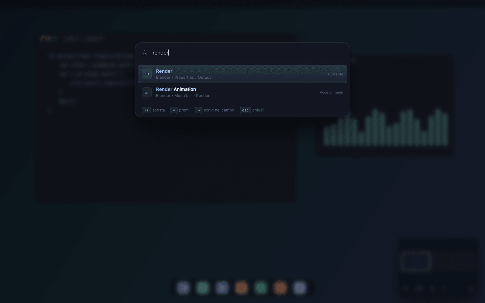 |
| 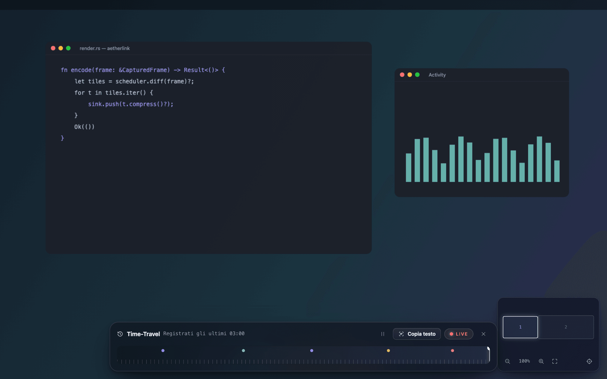 | 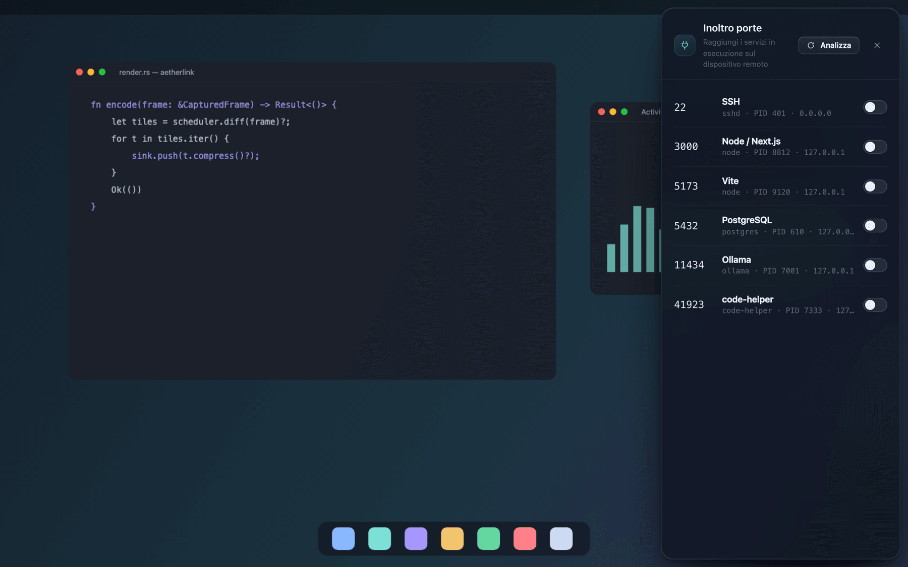 |
| 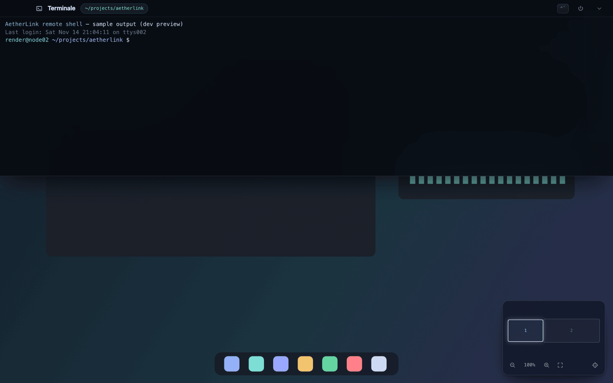 | 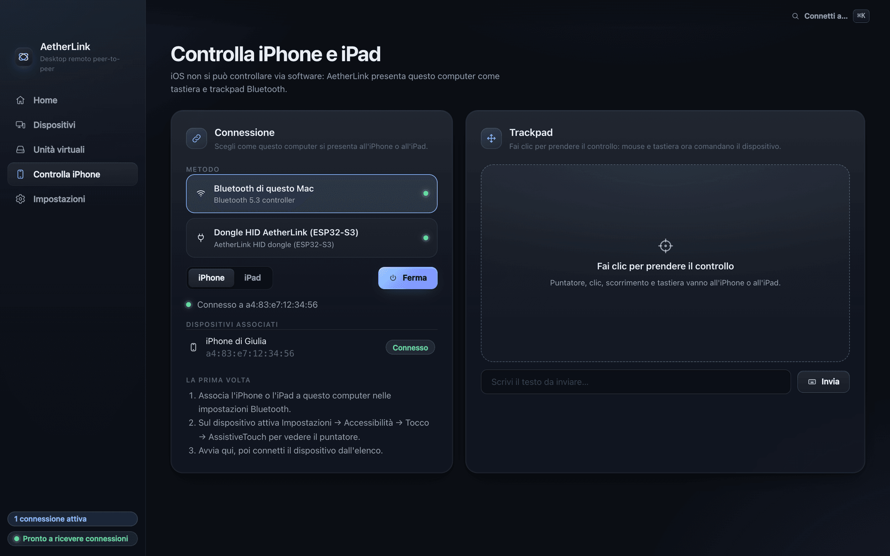 |
| 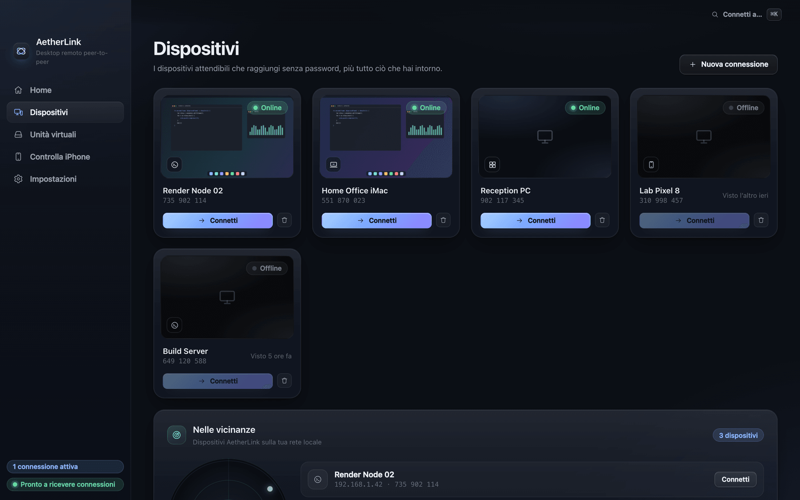 | 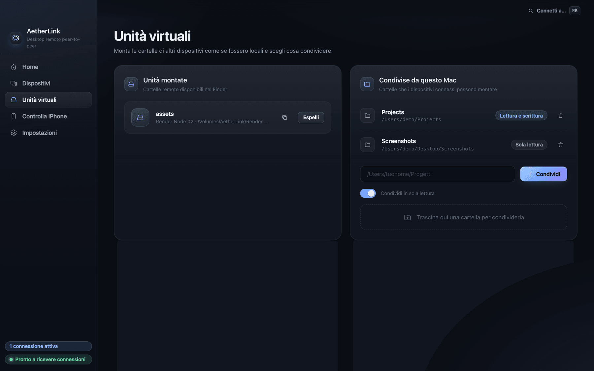 |
| 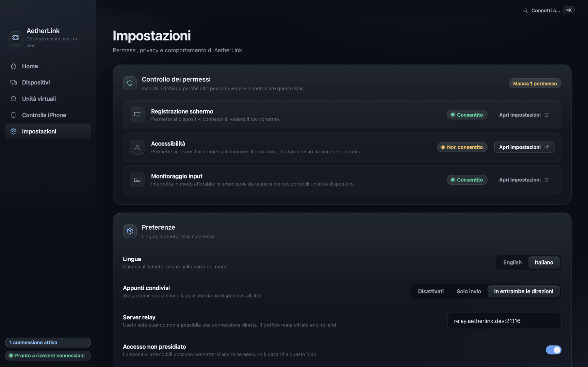 | |

<sub>Gli screenshot provengono dall'anteprima dell'interfaccia nel browser, con dati di esempio.</sub>

## Matrice di stato

**✅ eseguito** (girato su un sistema reale qui: Mac, container Linux, emulatore Android / simulatore iOS) ·
**🟡 compilato** (compila ed è pulito per clippy sul target; mai eseguito su quel sistema) ·
**⛔ non disponibile** (restituisce `Unsupported`, con il motivo)

| Area | macOS | Windows | Linux | Android | iOS |
|---|---|---|---|---|---|
| QUIC, TLS 1.3 + SPAKE2, relay, tunnel di porte | ✅ | 🟡 | ✅ | ✅ (emulatore ↔ Mac) | 🟡 |
| Cattura dello schermo | ✅ SCK, zero-copy | 🟡 DXGI + WGC | ✅ X11 SHM, nodo PipeWire · 🟡 portale Wayland | ✅ MediaProjection (emulatore) | 🟡 estensione ReplayKit (il simulatore non trasmette) |
| Codifica video | ✅ VT HEVC 4:4:4 | 🟡 Media Foundation | ✅ OpenH264 | ✅ MediaCodec H.264 (emulatore) | 🟡 VT nell'estensione |
| Riquadri senza perdita + rifinitura ibrida | ✅ | 🟡 | ✅ | – (visualizzatore: WebCodecs) | – |
| Cattura dell'audio di sistema | ✅ SCK | 🟡 WASAPI loopback | ✅ PipeWire + Pulse | 🟡 AudioPlaybackCapture | 🟡 audio ReplayKit |
| Trasporto e riproduzione Opus | ✅ (loopback 43,7 dB SNR, cpal) | 🟡 | ✅ codec · 🟡 riproduzione ALSA | 🟡 | 🟡 |
| Iniezione dell'input | 🟡 CGEvent (serve Accessibilità) | 🟡 SendInput + servizio SYSTEM | ✅ uinput, XTest · 🟡 portale | ✅ gesti di Accessibilità (emulatore) · 🟡 Shizuku | ⛔ per scelta del sistema → usa BT HID |
| Albero semantico dell'interfaccia (⌘K) | 🟡 AXUIElement | 🟡 UI Automation | ✅ AT-SPI (app GTK reale) | – | – |
| Unità montate nel sistema | ✅ NFSv3 | 🟡 unità WebDAV (server ✅ testato) | ✅ FUSE (senza root) | browser dei file | browser dei file |
| Sipario Ghost + retroilluminazione | ✅ livello di schermatura, ripristino esatto | 🟡 sipario in primo piano + `WDA_EXCLUDEFROMCAPTURE`, retroilluminazione WMI/DDC-CI | ✅ sipario X11 per ogni monitor RandR, escluso dal nostro catturatore X11 · ✅ retroilluminazione logind (testata con mock) · 🟡 Wayland → sipario nella webview | – | – |
| Schermo virtuale senza monitor | ✅ CGVirtualDisplay HiDPI | ⛔ serve un driver IddCx | ⛔ | – | – |
| Controllo di iPhone/iPad via HID | 🟡 IOBluetooth (record SDP + PSM 0x11/0x13 ✅) | 🟡 dongle seriale | 🟡 BlueZ (avvio/arresto ✅ nel container) | 🟡 BluetoothHidDevice | (destinazione) |
| Firmware del dongle HID ESP32-S3 | compila (arduino-cli, core ESP32 3.3.12); mai flashato | | | | |
| Controllo di UAC / schermata di blocco | – | 🟡 aether-winsvc | – | – | – |
| Conversione degli appunti, DVR, OCR | ✅ (OCR Vision) | 🟡 · 🟡 Windows.Media.Ocr | ✅ · ✅ ocrs (Rust puro; ripiego tesseract) | 🟡 | 🟡 |
| Redirezione USB | 🟡 host (libusb) | 🟡 host · ⛔ driver client | 🟡 host + client vhci-hcd | – | – |
| Sessione telefono → desktop | – | – | – | ✅ emulatore → Mac: connessione in 763 ms, H.264 864×1920, telemetria, tocco remoto | 🟡 serve un dispositivo (ReplayKit) |
| Compilazione delle app | ✅ .app + `--selftest-live` | 🟡 | 🟡 | ✅ APK, avviato | ✅ .app per simulatore, avviata |

### Self-test dal vivo sul Mac di sviluppo (M3 Max, macOS 27)

`aetherlink-desktop --selftest-live --with-virtual-display` ha restituito `"ok": true`:
- cattura reale con ScreenCaptureKit a 3600×2338, zero-copy;
- una sessione locale completa su QUIC che trasmette lo schermo reale in HEVC 4:4:4: connessione in 11 ms,
  prima immagine in 155 ms, password errata rifiutata, fotogrammi chiave registrati nel DVR;
- sipario Ghost a `CGShieldingWindowLevel` per 1 s, con la retroilluminazione portata a 0 e ripristinata
  esattamente;
- loopback Opus a 43,7 dB SNR con perdite e riordini simulati;
- uno schermo virtuale HiDPI 1920×1080 collegato e scollegato.

## Compilazione e verifica

```sh
# macOS
cargo clippy --workspace --all-targets -- -D warnings
AETHERLINK_NO_KEYCHAIN=1 cargo test --workspace            # 333 superati; 17 #[ignore] richiedono hardware/permessi
./target/debug/aetherlink-desktop --selftest-live [--with-virtual-display] [--no-ghost]   # report JSON

# Linux (test reali su Xvfb, PipeWire, AT-SPI/GTK, uinput, FUSE; test dal vivo Ghost/OCR in ci/linux-ghost-test.sh)
#   workspace: 353 superati, 0 falliti (+ tutti i test dal vivo dell'harness)
docker build -t aetherlink-linux -f ci/linux.Dockerfile ci
docker run --rm --device /dev/uinput --device-cgroup-rule='c 13:* rmw' --device /dev/fuse --cap-add SYS_ADMIN \
  --security-opt apparmor:unconfined -v "$PWD":/work -v aetherlink-target-linux:/work/target aetherlink-linux bash ci/linux-test.sh

# Windows (cross-compilazione da Linux/macOS)
docker build --platform linux/amd64 -t aetherlink-wincross -f ci/windows-cross.Dockerfile ci
docker run --rm --platform linux/amd64 -v "$PWD":/work aetherlink-wincross \
  cargo clippy --target x86_64-pc-windows-gnu --workspace --exclude aetherlink-mobile --all-targets -- -D warnings
# test di logica come veri binari Windows sotto Wine: 108 superati (codec incl. convertitore Media Foundation,
# dom, protocollo, DVR); le *API* Windows (DXGI, MF, SendInput, UIA…) richiedono ancora un Windows reale
docker run --rm --platform linux/amd64 -v "$PWD":/work aetherlink-wincross \
  cargo test --target x86_64-pc-windows-gnu -p aether-protocol -p aether-codec -p aether-timetravel -p aether-dom --lib

# Localizzazione dell'interfaccia (desktop + mobile, parità it/en, nessuna stringa scritta nel codice)
cd apps/mobile && npm install && npm run check

# App
cd apps/desktop && npx tauri build --bundles app
apps/mobile/scripts/e2e-android.sh --build        # emulatore → motore desktop, end to end
cd apps/mobile && npm run tauri -- android build --debug --apk --target aarch64
cd apps/mobile && npm run tauri -- ios build --target aarch64-sim --debug

# Anteprima dell'interfaccia nel browser (dati di esempio)
cd apps/desktop && npm run preview                # http://localhost:5178/
```

## Struttura del repository

```
crates/
  aether-protocol    tipi del protocollo + framing bincode con prefisso di lunghezza (contratto congelato)
  aether-net         QUIC (quinn/rustls), identità Ed25519, autenticazione SPAKE2, mDNS, STUN, rendezvous, tunnel di porte
  aether-capture     ScreenCaptureKit · DXGI Desktop Duplication / Windows.Graphics.Capture · portale PipeWire / X11 SHM;
                     audio di sistema: SCK · WASAPI loopback · monitor PipeWire/Pulse · PCM dai telefoni
  aether-codec       VideoToolbox HEVC 4:4:4 · Media Foundation H.264/HEVC · OpenH264; codec a riquadri senza perdita,
                     scheduler ibrido; Opus (port di libopus in Rust puro), jitter buffer, ricampionatore
  aether-input       CGEvent · SendInput (+ desktop sicuro) · uinput / XTest / portale RemoteDesktop ·
                     ponte Android; periferica Bluetooth HID (IOBluetooth, BlueZ) + dongle seriale ESP32-S3
  aether-dom         estrazione dell'albero AXUIElement · UI Automation · AT-SPI2, differenze, ricerca fuzzy, cartella corrente
  aether-vfs         RPC del file system remoto in sandbox, cache a blocchi BLAKE3; montaggi: NFSv3 (macOS), FUSE (Linux),
                     WebDAV + WNetAddConnection2 (Windows); trasferimento trascinando i file
  aether-display     Modalità Ghost (sipario escluso dalla cattura + retroilluminazione spenta: macOS/Windows/X11), schermi virtuali CGVirtualDisplay
  aether-timetravel  buffer circolare cifrato ChaCha20-Poly1305, consapevole dei GOP (DVR)
  aether-usb         formato USB/IP + backend host libusb + URB su QUIC
  aether-winsvc      servizio Windows LocalSystem: agente per sessione sui desktop Winlogon/Default (UAC, schermata di blocco)
  aether-core        facciata Engine: sessioni, pipeline media e audio, appunti, PTY, OCR, ponte HID, self-test
relay-server/        aether-relay: rendezvous + relay UDP cieco (pronto per Docker, ~3 MB di RSS a riposo)
apps/desktop/        app desktop Tauri 2 (macOS/Windows/Linux), icona nella barra dei menu, `--selftest-live`
apps/mobile/         app mobile Tauri 2 (Android + iOS) con livelli nativi Kotlin/Swift, moduli UI condivisi
firmware/            dongle HID USB/BLE ESP32-S3 (sketch Arduino)
ci/                  immagine di test Linux + harness, immagine di cross-compilazione per Windows
docs/ARCHITECTURE.md contratti dei crate, flusso dei dati, formato dei frame per l'interfaccia (in inglese)
```

## Modello di sicurezza

Ogni installazione ha un'identità Ed25519 (nel Portachiavi, con ripiego su file) e il suo certificato
TLS 1.3 contiene quella chiave. Dopo l'handshake TLS l'host riconosce una chiave già fidata (dispositivi
attendibili) oppure esegue SPAKE2 con la password monouso a rotazione, legata all'exporter TLS: così né un
relay né un attaccante in mezzo possono scoprire la password o dirottare la sessione. I tentativi di
password errati sono limitati per origine e globalmente. Il buffer del DVR è cifrato con una chiave di
sessione tenuta solo in memoria e mai salvata. La modalità Ghost salva i livelli di retroilluminazione
prima di oscurare, così un crash viene annullato al successivo avvio.

Essere connessi non significa poter fare tutto. Una sessione può sempre vedere lo schermo; tutto il resto è
un permesso separato, scelto in **Impostazioni → Accesso** e applicato dall'host: tastiera e mouse, appunti,
file, unità, azioni ⌘K, audio e schermi virtuali sono attivi per impostazione predefinita, mentre terminale
remoto, inoltro delle porte (solo verso un elenco esplicito di porte), redirezione USB e modalità Ghost
restano spenti finché non li attivi. Le modifiche valgono subito, anche per le sessioni già aperte. In più,
volendo, anche i dispositivi attendibili entrano solo dopo che chi è davanti al computer conferma con
Touch ID, Windows Hello o la password dell'account; se nessuno conferma, la connessione viene rifiutata.
Ogni sessione ha un limite di shell, tunnel e trasferimenti aperti, e il terminale remoto rallenta la shell
invece di accumulare output senza limiti.

## Limiti noti

* **Servono dispositivi reali, non testato qui:** l'abbinamento con un iPhone vero (IOBluetooth / BlueZ /
  Android / dongle), qualsiasi esecuzione su Windows, i portali Wayland, la trasmissione ReplayKit, Shizuku,
  gli encoder video hardware e la cattura dell'audio di sistema su un telefono fisico. Il percorso
  telefono → desktop è comunque verificato sull'emulatore Android (`apps/mobile/scripts/e2e-android.sh`).
* **Telemetria Android:** SELinux nasconde alle app i contatori di CPU e rete dell'intero sistema, quindi un
  host Android riporta solo l'uso di CPU di AetherLink e nessun dato di rete.
* **Bluetooth HID su macOS:** un processo utente può pubblicare il record SDP HID e registrare i PSM
  0x11/0x13 (verificato), ma non è verificato che bluetoothd gli instradi la connessione HID di un iPhone.
  Il Mac non può essere reso rilevabile dal codice: abbina prima l'iPhone, poi connettiti.
* **iOS** si può guardare (ReplayKit) ma mai controllare via software; per questo esistono le modalità HID.
  L'estensione richiede la firma con App Group; il motore resta attivo tramite la modalità audio in
  background (rischio in fase di App Review).
* **Schermi virtuali su Windows:** richiedono un driver IddCx firmato. L'unità WebDAV è soggetta al limite
  predefinito di 50 MB per file del servizio WebClient.
* **Linux:** il sipario Ghost X11 è nascosto solo al catturatore X11 di AetherLink; altri strumenti di cattura
  X11 lo vedono. Wayland non ha un sipario nativo (ripiego nella webview, che viene catturato). Il sipario
  lascia passare i clic (anche su Windows) perché l'input remoto funzioni: nasconde lo schermo ma non blocca
  l'input locale. L'OCR su Linux scarica al primo uso ~12 MB di modelli con hash SHA verificato. Wayland
  mostra due richieste di consenso (cattura e input) la prima volta.
* **Modalità Ghost su Windows:** richiede Windows 10 2004 o successivo per `WDA_EXCLUDEFROMCAPTURE`; le
  versioni precedenti ripiegano su `WDA_MONITOR`, e dall'altra parte si vede nero.
* Il relay è zero-knowledge sui contenuti ma vede i metadati (chi si connette a chi, volume di traffico).

## Supporta il progetto

Se AetherLink ti è utile, puoi sostenerne lo sviluppo:

<a href="https://paypal.me/giuseppegambino92"></a>

## Licenza

Doppia licenza [Apache-2.0](LICENSE-APACHE) o [MIT](LICENSE-MIT), a tua scelta.
