<p align="center">
  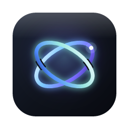
</p>

<h1 align="center">AetherLink</h1>

<p align="center">
  <b>English</b> | <a href="README.it.md">Italiano</a>
</p>

<p align="center">
  <a href="https://paypal.me/giuseppegambino92"></a>
</p>

<p align="center">
  <b>Peer-to-peer remote desktop that feels like a native app: sharp text, low latency, end-to-end encryption,
  and the remote machine's files, ports, terminal and UI one shortcut away.</b>
</p>

<p align="center">
  
  
  
  
  
  
  
</p>

<p align="center">
  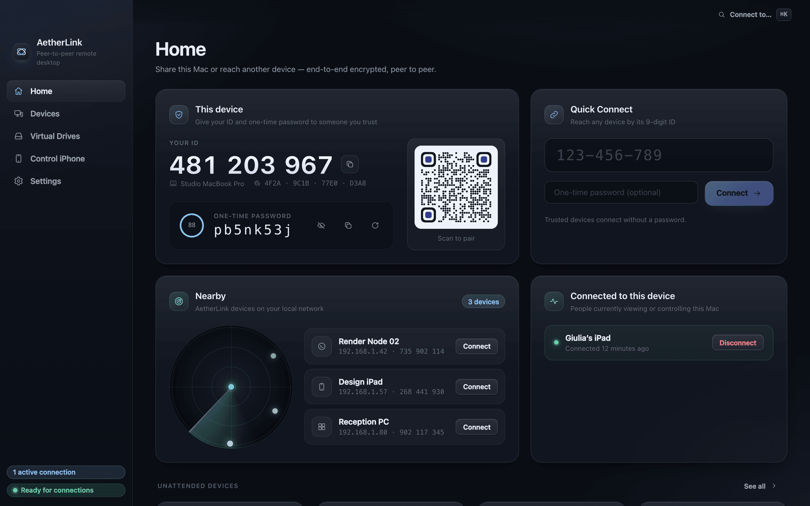
</p>

> **Status: pre-alpha.** Every platform backend exists in code and compiles for its target; how much of each
> has actually *run* differs. The [status matrix](#status-matrix) says exactly what ran where.

## What it does

### A picture that stays sharp
- **Hybrid video.** Hardware HEVC 4:4:4 (VideoToolbox, Media Foundation; OpenH264 fallback) for motion,
  plus **lossless text tiles** (xxh3 dirty tracking, zstd, deterministic cache) that refine still areas
  within 80 ms, so code and small fonts look exactly as they do on the remote screen.
- **Opus audio** over QUIC datagrams with a jitter buffer and a device picker in the HUD
  (ScreenCaptureKit, WASAPI loopback, PipeWire/Pulse).
- **Ultrawide navigator:** a picture-in-picture map of every remote display, with zoom and follow-the-pointer.

### The remote machine, as if it were local
- **⌘K semantic actions.** Search the remote UI tree (AXUIElement, UI Automation, AT-SPI) by name, then press
  buttons, open menus or type into fields without hunting for them on screen.
- **Native drive mount.** Remote folders appear in Finder, Explorer or your file manager (NFSv3 on macOS,
  WebDAV on Windows, FUSE on Linux), with a BLAKE3 chunk cache and drag-and-drop transfers.
- **Smart clipboard.** Images and rich text are converted between platform formats (macOS TIFF/HEIC,
  Windows DIBv5 and CF_HTML) through PNG/HTML on the wire.
- **Port forwarding.** Lists the services listening on the remote machine (SSH, Node, Postgres, Ollama…)
  and tunnels each to localhost with one switch.
- **Quake terminal.** Ctrl+` drops down a real remote shell, opened in the folder you are looking at.
- **3-minute Time-Travel DVR.** Scrub back through the last three minutes with event markers, and copy text
  from any past frame with on-device OCR. The buffer is encrypted with a key that never leaves RAM.

### Privacy and headless machines
- **Ghost Mode.** The remote screen goes dark for anyone in front of it (a curtain window at shielding level,
  backlight dimmed to zero and later restored exactly) while you keep working on it. Ctrl+Opt+Cmd+Esc lifts
  it locally.
- **Virtual displays.** Add a 1080p, 1440p or 32:9 display to a Mac with no monitor attached.

### iPhone, iPad and phones
- **Control an iPhone or iPad** by turning this computer, or an inexpensive ESP32-S3 dongle, into a Bluetooth
  keyboard and trackpad. iOS allows no software remote control; this works around it.
- **Mobile apps** for Android (MediaProjection, AccessibilityService, Shizuku) and iOS (ReplayKit) to share
  or view a phone.

### Security
- Ed25519 device identity, a 9-digit ID, a rotating one-time password, **SPAKE2 bound to TLS 1.3**, and
  trusted devices pinned by key. The self-hostable relay is **zero-knowledge**: it forwards encrypted
  packets and never sees content.

## Screenshots

| | |
|---|---|
| 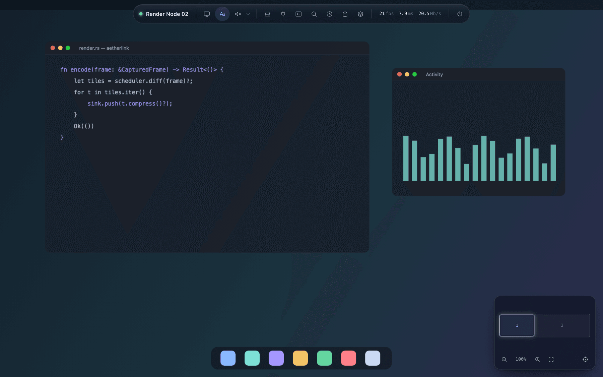 | 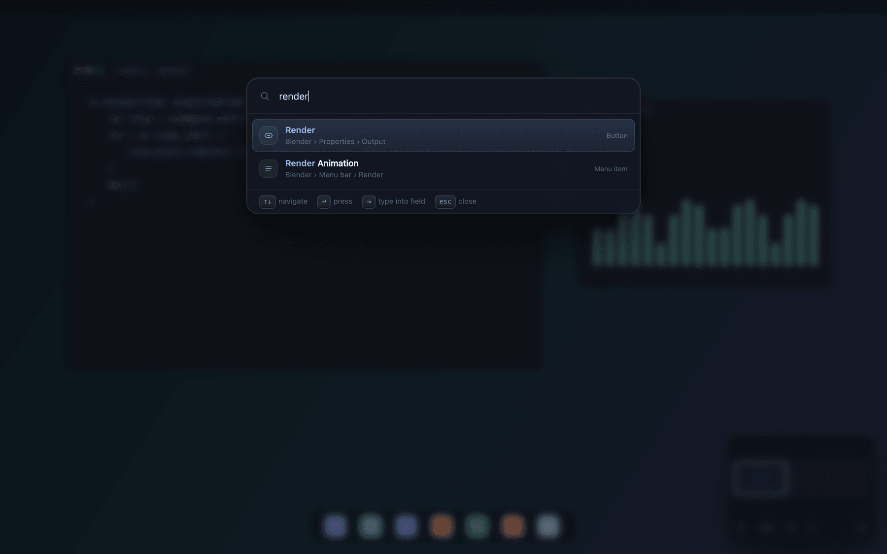 |
| 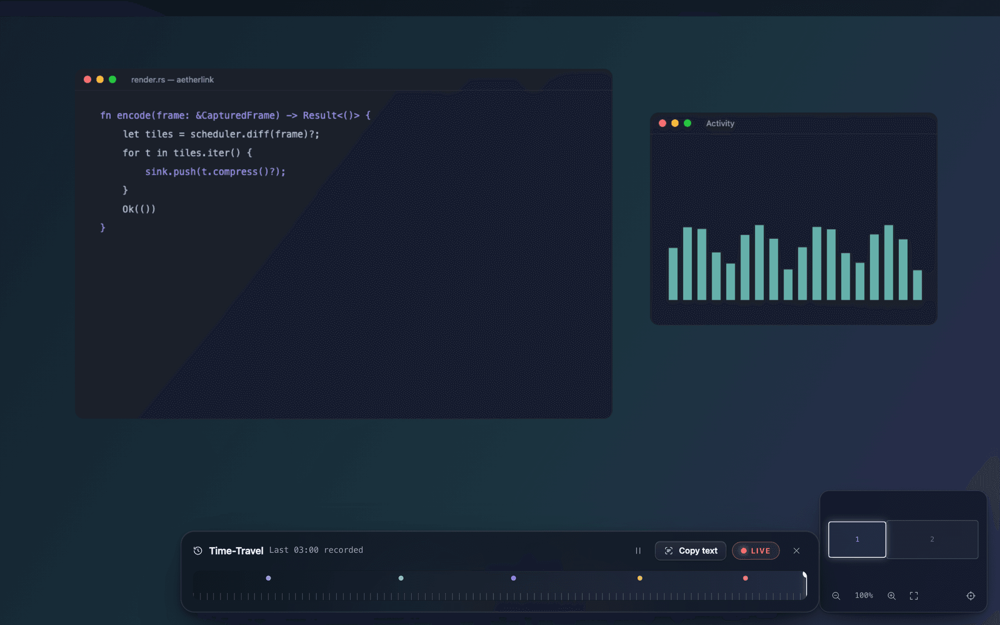 | 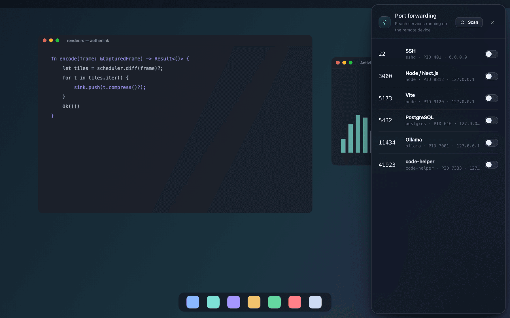 |
| 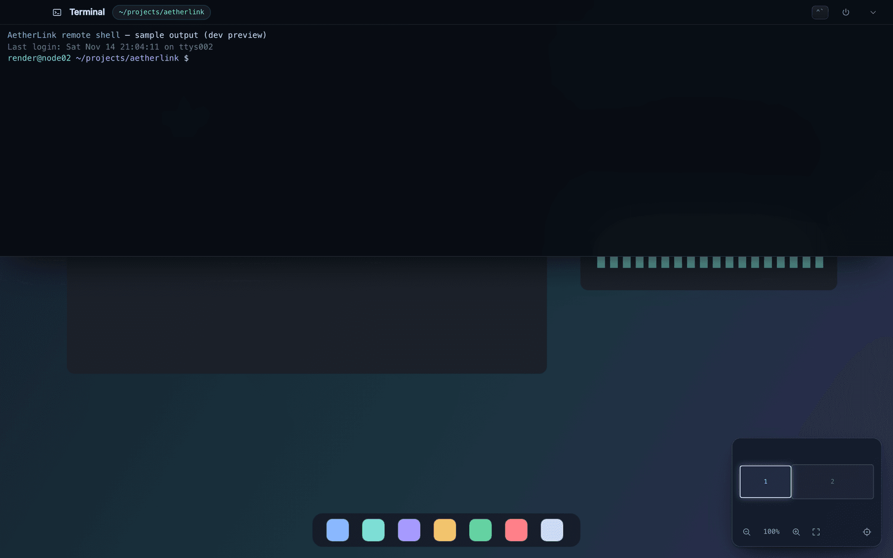 | 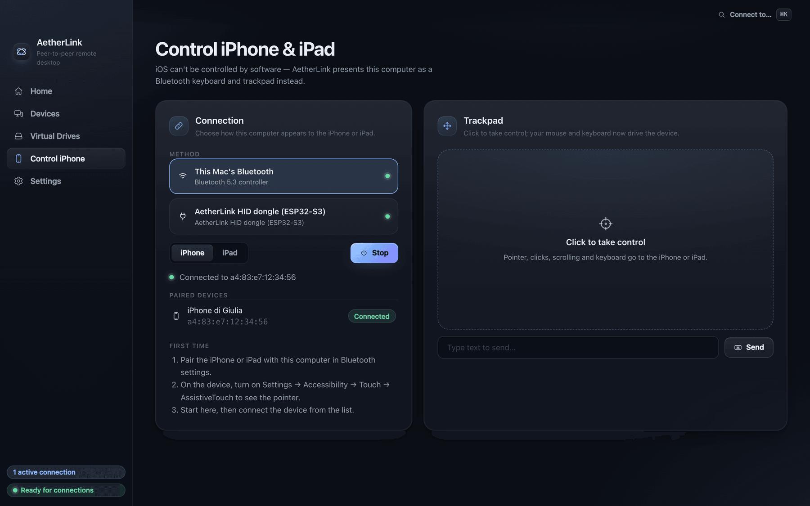 |
| 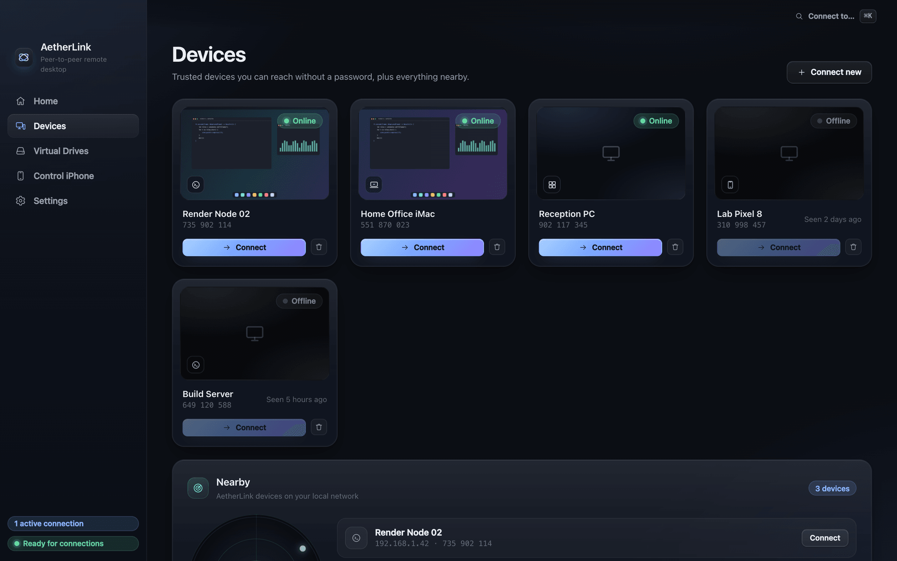 | 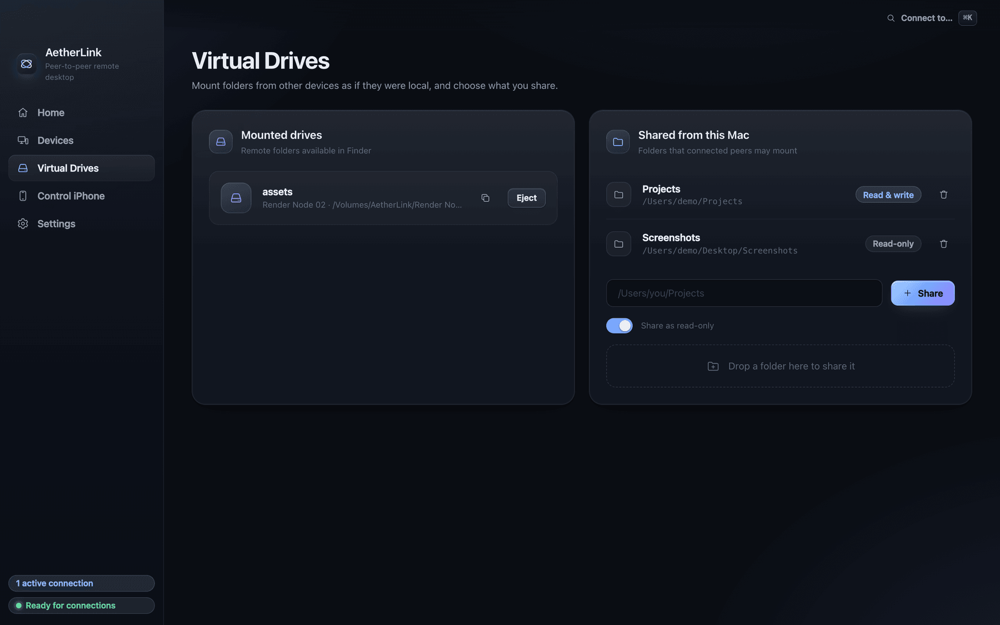 |
| 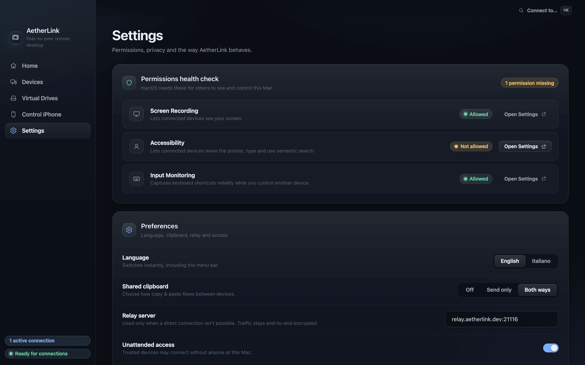 | |

<sub>Screenshots come from the UI's browser preview with sample data.</sub>

## Status matrix

**✅ executed** (ran on a real OS here: macOS host, Linux container, Android emulator / iOS simulator) ·
**🟡 compiled** (builds and is clippy-clean for the target; never executed on that OS) ·
**⛔ not available** (returns `Unsupported`, reason given)

| Area | macOS | Windows | Linux | Android | iOS |
|---|---|---|---|---|---|
| QUIC, TLS 1.3 + SPAKE2, relay, port tunnels | ✅ | 🟡 | ✅ | ✅ (emulator ↔ Mac) | 🟡 |
| Screen capture | ✅ SCK, zero-copy | 🟡 DXGI + WGC | ✅ X11 SHM, PipeWire node · 🟡 Wayland portal | ✅ MediaProjection (emulator) | 🟡 ReplayKit ext (sim can't broadcast) |
| Video encode | ✅ VT HEVC 4:4:4 | 🟡 Media Foundation | ✅ OpenH264 | ✅ MediaCodec H.264 (emulator) | 🟡 VT in extension |
| Lossless tiles + hybrid refinement | ✅ | 🟡 | ✅ | – (viewer: WebCodecs) | – |
| System audio capture | ✅ SCK | 🟡 WASAPI loopback | ✅ PipeWire + Pulse | 🟡 AudioPlaybackCapture | 🟡 ReplayKit audio |
| Opus transport + playback | ✅ (loopback 43.7 dB SNR, cpal) | 🟡 | ✅ codec · 🟡 ALSA playback | 🟡 | 🟡 |
| Input injection | 🟡 CGEvent (needs Accessibility) | 🟡 SendInput + SYSTEM service | ✅ uinput, XTest · 🟡 portal | ✅ Accessibility gestures (emulator) · 🟡 Shizuku | ⛔ by OS design → use BT HID |
| Semantic UI tree (⌘K) | 🟡 AXUIElement | 🟡 UI Automation | ✅ AT-SPI (live GTK app) | – | – |
| Native drive mount | ✅ NFSv3 | 🟡 WebDAV drive (server ✅ tested) | ✅ FUSE (no root) | file browser | file browser |
| Ghost Mode curtain + backlight | ✅ shielding level, exact restore | 🟡 topmost curtain + `WDA_EXCLUDEFROMCAPTURE`, WMI/DDC-CI backlight | ✅ X11 curtain per RandR monitor, excluded by our X11 capturer · ✅ logind backlight (mock-tested) · 🟡 Wayland → webview curtain | – | – |
| Headless virtual display | ✅ CGVirtualDisplay HiDPI | ⛔ needs an IddCx driver | ⛔ | – | – |
| Control iPhone/iPad via HID | 🟡 IOBluetooth (SDP + PSM 0x11/0x13 probe ✅) | 🟡 serial dongle | 🟡 BlueZ (start/stop ✅ in container) | 🟡 BluetoothHidDevice | (target) |
| ESP32-S3 HID dongle firmware | compiles (arduino-cli, ESP32 core 3.3.12); never flashed | | | | |
| UAC / lock screen control | – | 🟡 aether-winsvc | – | – | – |
| Clipboard transcoding, DVR, OCR | ✅ (Vision OCR) | 🟡 · 🟡 Windows.Media.Ocr | ✅ · ✅ ocrs (pure Rust; tesseract fallback) | 🟡 | 🟡 |
| USB redirection | 🟡 host (libusb) | 🟡 host · ⛔ client driver | 🟡 host + vhci-hcd client | – | – |
| Phone → desktop session | – | – | – | ✅ emulator → Mac: connect 763 ms, H.264 864×1920, telemetry, remote tap | 🟡 needs a device (ReplayKit) |
| App build | ✅ .app + `--selftest-live` | 🟡 | 🟡 | ✅ APK, launched | ✅ sim .app, launched |

### Live self-test on the development Mac (M3 Max, macOS 27)

`aetherlink-desktop --selftest-live --with-virtual-display` returned `"ok": true`:
- real ScreenCaptureKit capture at 3600×2338, zero-copy;
- a full local session over QUIC streaming the real screen in HEVC 4:4:4: connect in 11 ms, first picture
  in 155 ms, wrong password rejected, DVR keyframes recorded;
- Ghost Mode curtain at `CGShieldingWindowLevel` for 1 s, with the backlight dimmed to 0 and restored exactly;
- Opus loopback at 43.7 dB SNR with injected loss and reordering;
- a HiDPI 1920×1080 virtual display attached and detached.

## Build and verify

```sh
# macOS
cargo clippy --workspace --all-targets -- -D warnings
AETHERLINK_NO_KEYCHAIN=1 cargo test --workspace            # 333 passed; 17 #[ignore] need hardware/permissions
./target/debug/aetherlink-desktop --selftest-live [--with-virtual-display] [--no-ghost]   # JSON health report

# Linux (real tests on Xvfb, PipeWire, AT-SPI/GTK, uinput, FUSE; Ghost/OCR live tests in ci/linux-ghost-test.sh)
#   workspace: 353 passed, 0 failed (+ all live harness tests)
docker build -t aetherlink-linux -f ci/linux.Dockerfile ci
docker run --rm --device /dev/uinput --device-cgroup-rule='c 13:* rmw' --device /dev/fuse --cap-add SYS_ADMIN \
  --security-opt apparmor:unconfined -v "$PWD":/work -v aetherlink-target-linux:/work/target aetherlink-linux bash ci/linux-test.sh

# Windows (cross-compile from Linux/macOS)
docker build --platform linux/amd64 -t aetherlink-wincross -f ci/windows-cross.Dockerfile ci
docker run --rm --platform linux/amd64 -v "$PWD":/work aetherlink-wincross \
  cargo clippy --target x86_64-pc-windows-gnu --workspace --exclude aetherlink-mobile --all-targets -- -D warnings
# pure-logic tests as real Windows binaries under Wine: 108 passed (codec incl. Media Foundation
# converter, dom, protocol, DVR); Windows *APIs* (DXGI, MF, SendInput, UIA…) still need real Windows
docker run --rm --platform linux/amd64 -v "$PWD":/work aetherlink-wincross \
  cargo test --target x86_64-pc-windows-gnu -p aether-protocol -p aether-codec -p aether-timetravel -p aether-dom --lib

# UI localization (desktop + mobile, it/en parity, no hard-coded strings)
cd apps/mobile && npm install && npm run check

# Apps
cd apps/desktop && npx tauri build --bundles app
apps/mobile/scripts/e2e-android.sh --build        # emulator host → desktop engine, end to end
cd apps/mobile && npm run tauri -- android build --debug --apk --target aarch64
cd apps/mobile && npm run tauri -- ios build --target aarch64-sim --debug

# UI preview in the browser (sample data)
cd apps/desktop && npm run preview                # http://localhost:5178/
```

## Repository layout

```
crates/
  aether-protocol    wire types + length-prefixed bincode framing (frozen contract)
  aether-net         QUIC (quinn/rustls), Ed25519 identity, SPAKE2 auth, mDNS, STUN, rendezvous, port tunnels
  aether-capture     ScreenCaptureKit · DXGI Desktop Duplication / Windows.Graphics.Capture · PipeWire portal / X11 SHM;
                     system audio: SCK · WASAPI loopback · PipeWire/Pulse monitor · mobile PCM push
  aether-codec       VideoToolbox HEVC 4:4:4 · Media Foundation H.264/HEVC · OpenH264; lossless tile codec,
                     hybrid scheduler; Opus (pure-Rust libopus port), jitter buffer, resampler
  aether-input       CGEvent · SendInput (+ secure-desktop following) · uinput / XTest / RemoteDesktop portal ·
                     Android bridge; Bluetooth HID peripheral (IOBluetooth, BlueZ) + ESP32-S3 serial dongle
  aether-dom         AXUIElement · UI Automation · AT-SPI2 tree extraction, diffing, fuzzy search, cwd detection
  aether-vfs         sandboxed remote FS RPC, BLAKE3 chunk cache; mounts: NFSv3 (macOS), FUSE (Linux),
                     WebDAV + WNetAddConnection2 (Windows); drag-and-drop transfer
  aether-display     Ghost Mode (capture-excluded curtain + backlight off: macOS/Windows/X11), CGVirtualDisplay headless displays
  aether-timetravel  ChaCha20-Poly1305 encrypted GOP-aware ring buffer (DVR)
  aether-usb         USB/IP wire format + libusb host backend + URB-over-QUIC
  aether-winsvc      Windows LocalSystem service: per-session agent on Winlogon/Default desktops (UAC, lock screen)
  aether-core        Engine facade: sessions, media + audio pipelines, clipboard, PTY, OCR, HID bridge, self-test
relay-server/        aether-relay: rendezvous + blind UDP relay (Docker-ready, ~3 MB RSS idle)
apps/desktop/        Tauri 2 desktop app (macOS/Windows/Linux), menu-bar item, `--selftest-live`
apps/mobile/         Tauri 2 mobile app (Android + iOS) with Kotlin/Swift native layers, shared UI modules
firmware/            ESP32-S3 USB/BLE HID dongle (Arduino sketch)
ci/                  Linux test image + harness, Windows cross-compile image
docs/ARCHITECTURE.md crate contracts, data flow, UI frame format
```

## Security model

Every install has an Ed25519 identity (Keychain, with a file fallback), and its TLS 1.3 certificate carries
that key. After the TLS handshake the host either recognises a pinned key (trusted devices) or runs SPAKE2
with the rotating one-time password, bound to the TLS exporter, so a relay or a man in the middle can neither
learn the password nor splice the session. Failed password attempts are rate-limited per source and
globally. The DVR buffer is encrypted with a per-session in-memory key that is never persisted. Ghost Mode
saves backlight levels before dimming, so a crash is undone at the next launch.

## Known limitations

* **Needs real devices, untested here:** pairing with an actual iPhone (IOBluetooth / BlueZ / Android /
  dongle), anything on Windows at runtime, Wayland portals, ReplayKit broadcast, Shizuku, hardware video
  encoders and system-audio capture on a physical phone. The phone → desktop path itself is verified on
  the Android emulator (`apps/mobile/scripts/e2e-android.sh`).
* **Android telemetry:** SELinux hides system-wide CPU and network counters from apps, so an Android host
  reports AetherLink's own CPU usage and no network throughput.
* **macOS Bluetooth HID:** a user process can publish the HID SDP record and register PSM 0x11/0x13
  (verified), but whether bluetoothd routes an iPhone's HID connection to it is unverified. The Mac cannot
  be made discoverable from code, so pair the iPhone first, then connect.
* **iOS** can be viewed (ReplayKit) but never input-controlled by software; that is what the HID modes are
  for. The extension needs App Group signing; the engine stays alive through an audio background mode
  (App Review risk).
* **Windows virtual displays** need a signed IddCx driver. The WebDAV drive is subject to the WebClient
  50 MB default file-size limit.
* **Linux:** the X11 Ghost curtain is hidden only from AetherLink's own X11 capturer; other X11 capture
  tools see it. Wayland has no native curtain (a webview fallback, which is captured). The curtain is
  click-through (also on Windows) so remote input works; it hides the screen but does not block local input.
  Linux OCR downloads ~12 MB of SHA-pinned models on first use. Wayland shows two consent dialogs
  (capture and input) the first time.
* **Windows Ghost Mode** needs Windows 10 2004+ for `WDA_EXCLUDEFROMCAPTURE`; older builds fall back to
  `WDA_MONITOR`, where the remote side sees black.
* The relay is zero-knowledge for content but sees metadata (who connects to whom, traffic volume).

## Support

If AetherLink is useful to you, you can support its development:

<a href="https://paypal.me/giuseppegambino92"></a>

## License

Dual-licensed under [Apache-2.0](LICENSE-APACHE) or [MIT](LICENSE-MIT), at your option.
